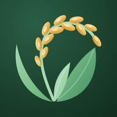
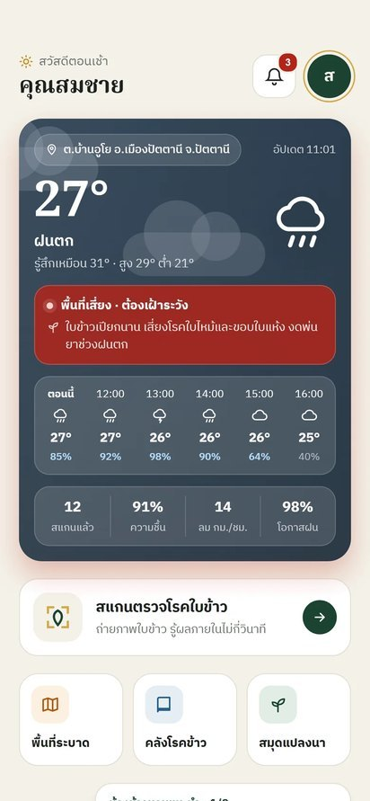
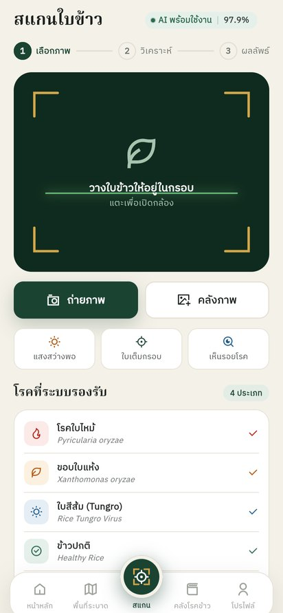
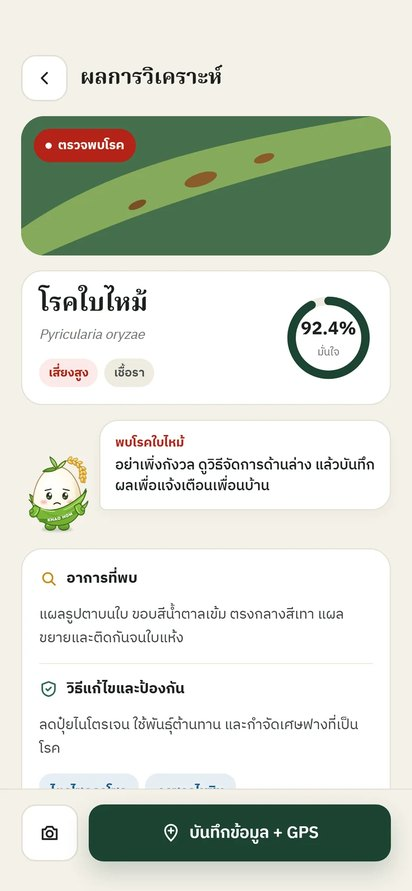
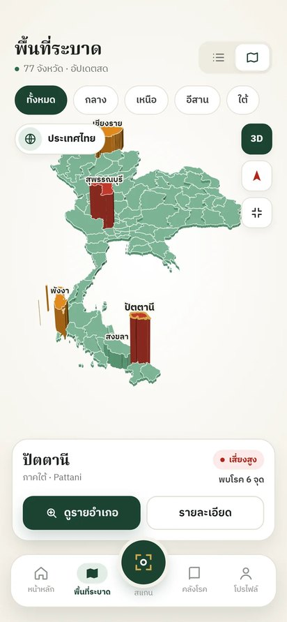

<div align="center">



# Rice AI · รุ่นเบต้า (Android)

**ถ่ายรูปใบข้าว รู้โรคในไม่กี่วินาที ใช้ได้แม้ไม่มีสัญญาณอินเทอร์เน็ต**

[](https://github.com/BURHANJJ/rice-ai-beta/releases/latest)


[ดาวน์โหลด](#ดาวน์โหลด) · [ใช้ได้อะไรบ้าง](#ใช้ได้ในรุ่นนี้) · [วิธีติดตั้ง](#วิธีติดตั้ง) · [แจ้งปัญหา](https://github.com/BURHANJJ/rice-ai-beta/issues/new/choose) · [เว็บไซต์](https://rice-ai-appp.web.app)

</div>

<p align="center">
  
  
  
  
</p>

Rice AI ช่วยเกษตรกรดูว่าใบข้าวเป็นโรคอะไร แยกได้ 4 แบบ คือ **โรคใบไหม้ โรคขอบใบแห้ง โรคใบสีส้ม และใบปกติ** พร้อมคำแนะนำการจัดการจากกรมการข้าว ถ้าภาพดูเป็นโรคอื่นที่แอปยังไม่รองรับ แอปจะบอกตรง ๆ แทนการเดาชื่อโรค

รุ่นนี้เป็นรุ่นทดสอบ เปิดให้ลองใช้และเก็บความคิดเห็นก่อนเปิดให้บริการจริงบน Google Play

## ดาวน์โหลด

ไปที่ **[หน้า Releases](https://github.com/BURHANJJ/rice-ai-beta/releases/latest)** แล้วเลือกไฟล์ตามเครื่อง

| ไฟล์ | ใช้กับ | ขนาด |
|---|---|---|
| `rice-ai-beta-0.9.4-arm64.apk` | โทรศัพท์ Android ทั่วไป **(แนะนำ)** | 42.0 MB |
| `rice-ai-beta-0.9.4-arm32.apk` | เครื่องรุ่นเก่าที่ติดตั้งไฟล์แรกไม่ได้ | 37.5 MB |

ต้องใช้ Android 6.0 ขึ้นไป ยังไม่มีรุ่นสำหรับ iPhone

## ใช้ได้ในรุ่นนี้

| ฟีเจอร์ | รายละเอียด |
|---|---|
| สแกนใบข้าว | ถ่ายรูปหรือเลือกจากคลังภาพ AI บอกโรคพร้อมค่าความมั่นใจ |
| AI บนเครื่อง | วิเคราะห์ในโทรศัพท์ทั้งหมด ไม่ต้องใช้อินเทอร์เน็ตตอนสแกน |
| รู้ขอบเขตตัวเอง | ถ้าภาพดูเป็นโรคอื่น (เช่น ใบจุดสีน้ำตาล แมลงดำหนาม) จะแนะนำให้ปรึกษาเจ้าหน้าที่ แทนการให้ชื่อโรคที่ผิด |
| กรองรูปไม่ชัด | ถ้า AI มั่นใจต่ำกว่า 60% จะไม่เดาผล แต่บอกเหตุผลและวิธีถ่ายใหม่ให้แม่นขึ้น |
| คำแนะนำ | อาการ สาเหตุ วิธีจัดการ และสารเคมีตามกรมการข้าว |
| บันทึกผล | เก็บผลพร้อมพิกัด GPS มีหน้าสรุปบอกว่าส่งเข้าระบบแล้วหรือรอสัญญาณ ดูประวัติย้อนหลังได้ |
| แผนที่ระบาด | แผนที่ 3 มิติ 77 จังหวัด เจาะดูรายอำเภอได้ |
| ข้อมูลอื่น | คลังโรคข้าว (4 แบบที่ AI ตรวจได้ ส่วนครบ 22 โรคดูได้บน[เว็บไซต์](https://rice-ai-appp.web.app/rice-diseases)) สมุดแปลงนา สภาพอากาศรายชั่วโมง |
| บัญชีผู้ใช้ | สมัครด้วยอีเมล หรือเข้าสู่ระบบด้วยบัญชี Google |

## ข้อควรรู้

- **ต้องเข้าสู่ระบบครั้งแรกตอนมีอินเทอร์เน็ต** หลังจากนั้นเปิดแอปและสแกนในที่ไม่มีสัญญาณได้ ผลจะส่งขึ้นระบบเองเมื่อกลับมามีสัญญาณ
- ตำแหน่ง GPS ใช้ได้ไม่ต้องมีเน็ต แต่ชื่อตำบล/อำเภอจะขึ้นเมื่อมีเน็ต
- ประกาศเตือนการระบาดจากเจ้าหน้าที่เข้ากล่องแจ้งเตือนในแอป อาจช้าได้ถึง 15 นาที (ยังไม่มี Push ทันที)
- ความแม่นยำ 96.9% วัดจากชุดภาพทดสอบ 761 ภาพที่ AI ไม่เคยเห็น และไม่ให้ชื่อโรคกับภาพโรคอื่นได้ 98% รูปจากแปลงนาในไทยอาจได้ผลต่างไป
- โรคอื่นที่แอปรู้จักว่า "อยู่นอกขอบเขต" มีเฉพาะ 6 ชนิดในชุดข้อมูล Paddy Doctor ภาพที่ไม่ใช่ใบข้าวเลยยังอาศัยค่าความมั่นใจ
- ผลจาก AI เป็นเครื่องมือช่วยตัดสินใจเบื้องต้น ควรปรึกษาเจ้าหน้าที่เกษตรก่อนใช้สารเคมี

## วิธีติดตั้ง

1. เปิดหน้า [Releases](https://github.com/BURHANJJ/rice-ai-beta/releases/latest) บนโทรศัพท์ แตะไฟล์ `arm64` เพื่อดาวน์โหลด
2. เปิดไฟล์ที่ดาวน์โหลด ถ้าเครื่องถาม ให้อนุญาต **"ติดตั้งแอปที่ไม่รู้จัก"** สำหรับเบราว์เซอร์ที่ใช้
3. แตะ **ติดตั้ง** แล้วเปิดแอป Rice AI สมัครหรือเข้าสู่ระบบ

ถ้าขึ้นว่า "แอปไม่ได้ติดตั้ง" ให้ลองไฟล์ `arm32` แทน

## ตรวจสอบไฟล์

ไฟล์ `SHA256SUMS.txt` ในหน้า Release มีค่าตรวจสอบของแต่ละไฟล์ บนคอมพิวเตอร์ตรวจได้ด้วย

```bash
sha256sum -c SHA256SUMS.txt        # macOS / Linux
certutil -hashfile rice-ai-beta-0.9.4-arm64.apk SHA256   # Windows
```

## ความเป็นส่วนตัว

แอปเก็บอีเมล ชื่อ รูปที่สแกน ผลวิเคราะห์ และพิกัด (เมื่ออนุญาต) ไว้บน Firebase ของโครงการ เพื่อแสดงประวัติและทำแผนที่ระบาด แผนที่สาธารณะแสดงเฉพาะจำนวนรายจังหวัด ไม่แสดงชื่อหรือพิกัดของผู้ใช้ รายละเอียดอยู่ที่ [นโยบายความเป็นส่วนตัว](https://rice-ai-appp.web.app/privacy) และ [เงื่อนไขการให้บริการ](https://rice-ai-appp.web.app/terms)

## แจ้งปัญหาหรือเสนอแนะ

เปิด [Issue ใหม่](https://github.com/BURHANJJ/rice-ai-beta/issues/new/choose) เลือก "แจ้งปัญหา" หรือ "ข้อเสนอแนะ" บอกรุ่นโทรศัพท์และเวอร์ชัน Android ด้วยจะช่วยได้มาก

## ประวัติรุ่น

ดู [CHANGELOG.md](CHANGELOG.md)

---

<sub>โครงงาน “การจำแนกโรคของใบข้าวด้วย Machine Learning” · สาขาวิชาคอมพิวเตอร์และวิทยาการสารสนเทศเพื่อการจัดการ คณะวิทยาการสื่อสาร มหาวิทยาลัยสงขลานครินทร์ วิทยาเขตปัตตานี · ข้อมูลโรคข้าวจากกรมการข้าว · repo นี้เก็บเฉพาะไฟล์ติดตั้งและเอกสาร ไม่มีซอร์สโค้ด</sub>
